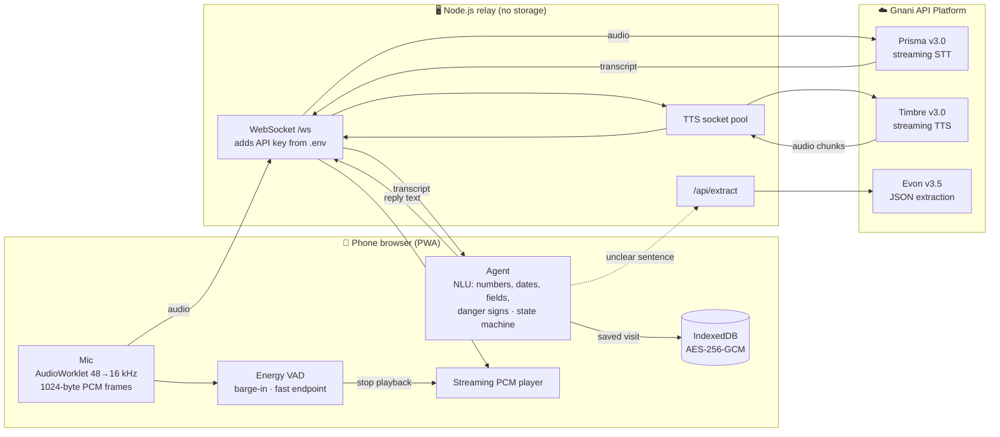

# ASHA Vaani: a voice field register for ASHA workers

**Track:** Healthcare – Voice field register for ASHA workers · **BolBharat, the Gnani Voice AI Innovation Challenge**

**▶ Live app:** _deployed link here_ · **🎬 Demo video (2½ min):** _video link here_

An ASHA worker walks out of a house and *speaks* her visit notes in any of the ten languages Gnani supports (Hindi, Marathi, Bengali,
Gujarati, Punjabi, Tamil, Telugu, Kannada, Malayalam, English), mixed with English however she naturally talks. Before she reaches the next house she has:

1. **A correct visit record**: beneficiary ID and name, visit type, weight, vitals, vaccines given and **vaccines due**
   (worked out from the national schedule), and the next visit date.
2. **The record read back aloud**, which she fixes by voice ("नहीं, वज़न 2.8 किलो").
3. **An immediate spoken danger-sign alert** in her language ("refer to the PHC now"), with the record flagged and one-tap
   108 / PHC call buttons.
4. **A follow-up list**: referrals first, then overdue, today, the next 7 days and later. She can ask "aaj ki list".
5. **Saved visits she can reopen and correct**, and an unfinished visit that survives a reload.
6. **Referral follow-through.** From the day after a referral, "aaj ki list" asks *"did she reach the PHC?"*. She answers
   yes or no by voice (or taps a button). "Not yet" keeps the woman at the top of the list and asks again the next day.
   Field studies find referred high-risk women are often never reminded or accompanied
   ([BMC Pregnancy & Childbirth 2022](https://link.springer.com/doi/10.1186/s12884-022-04601-6)), so the app keeps asking until she has gone.
7. **Measured time per visit.** Every saved visit shows how long recording took, from her first word to the save, with
   the average and total on the Records tab. "Faster than paper" becomes a number, not a claim.
8. **This month's activity counts** for her monthly incentive claim: visits by type, vaccine doses given, referrals
   advised and referrals that reached the PHC. Counts only, no rupee amounts (they differ by state).
9. **Register page.** One day's visits as a table in register column order, to copy into the official register or
   show the ANM, as a CSV download (opens in Excel with Indic text intact) or a clean printout. She speaks once and
   copies, so nothing is entered twice from memory.
10. **Measured data use.** Settings shows the mobile data the voice connection used this session and since the last
    save (sent / received). Each saved visit keeps its figure, and the Records tab shows the average per visit. ASHAs pay
    for their own data, so this is the cost question answered with a number.
11. **Remembers the last visit.** Once she names the person, the card shows the last saved visit (date, weight,
    vaccines, referral), and the read-back says the last weight too: *"weight 52 kilo, last visit 5 November it was
    50 kilo"*. A mis-heard number or a real drop stands out at once. Vaccines given at earlier saved visits count, so
    Td-1 given last month is not asked for again, and Td-2 is due four weeks later.
12. **Vaccination-day list.** "tike ki list" speaks everyone due a vaccine now, grouped by vaccine; the Follow-ups tab
    shows one row per family with all their due vaccines, by ward. Register people are worked out from the national
    schedule, minus what was given at saved visits. She uses it to call
    families before the village health and nutrition day.
13. **It asks; she answers in her own words.** The agent asks one thing at a time ("whose home are you at?", "what is the
    weight?") and takes the answer however she says it: "पेट से है" (pregnant), "डिलीवरी हो गई" (after delivery), "दस
    बयालीस" (ID 1042 read in pairs), "करीब पचास" (about 50), "पखवाड़े भर बाद" (in a fortnight), "वही रखो" (keep the
    suggested date), "सेव कर दीजिए". "Not weighed today" and "don't know" are recorded as such, never as a number or as
    "no vaccine due". When it doesn't follow, it repeats the question with an example answer instead of "say it again".

No typing needed (a type box is there for when there is no internet). The app runs in the phone's browser and can be
installed as a PWA on a low-end Android phone.

> **Prototype.** ASHA Vaani is a hackathon prototype that uses invented demo people. It is not an official health record,
> does not replace the MCP card, the RCH register or ANMOL, and is not connected to any government system. See
> [Prototype status and limitations](#prototype-status-and-limitations).

```
→ "…किसके घर पर हैं? नाम या आईडी बताइए।"        "सुनीता देवी के यहाँ हूँ"
→ "वज़न कितना है?"                              "करीब बावन"
→ "अगली विज़िट कब है? शेड्यूल के हिसाब से …"    "पखवाड़े भर बाद"
→ "पढ़कर सुनाती हूँ। सुनीता देवी, आईडी एक शून्य चार दो। ए एन सी विज़िट। वज़न बावन किलो।
   बाकी टीके: टी डी दूसरा। अगली विज़िट पांच दिसंबर। क्या सब सही है?"   "हाँ, सेव कर दीजिए"
→ saved on this phone (encrypted; not synced anywhere) → follow-up list updated
```
Saying it all in one breath works too: "सुनीता देवी, आईडी 1042, वज़न 52 किलो, अगली विज़िट 3 दिसंबर".

---

## Try it in 2 minutes

Requirements: Node.js 20+ and a Gnani API key from https://app.gnani.ai/voice.

```bash
git clone <this repo> && cd asha-vaani
npm install
cp .env.example .env          # then put your key in GNANI_API_KEY=...
npm start                     # http://localhost:3000
```

Open http://localhost:3000 in Chrome, tap the big mic, allow microphone access, and talk.

- **No key yet?** It still runs. The header shows `browser speech`, and the app falls back to the browser's speech
  recognition and voice. Gnani is used automatically once `GNANI_API_KEY` is set.
- **No mic?** Visit tab → *Type instead* sends text straight to the same agent.
- **On a phone:** the mic needs HTTPS, so use the deployed link (below) or a tunnel such as `npx localtunnel --port 3000`.

### Demo script (what we say to the judges)

| Say | What happens |
|---|---|
| *(tap mic)* | The agent says it is an AI assistant, not a human, in the selected language, and asks whose home she is at |
| "kya bolna hai?" | Explains it asks one thing at a time, then repeats the question with an example answer |
| "Sunita ki visit, wajan 50 kilo" | Two Sunitas are in the register, so it asks which one (ward / husband / ID) |
| "ward 3 wali" | Resolves to Sunita Devi 1042. Visit type ANC comes from the register |
| "agli visit do hafte baad, bas" | Fills the date, then reads the whole form back |
| "nahi, weight 52 kilo" *(while it is still talking)* | Barge-in: it stops at once, fixes the weight and reads back only what changed |
| "haan" | Saved and encrypted. The follow-up list updates |
| "Rekha Devi 1083, khoon aa raha hai" | Spoken danger alert straight away, a red alert card with the signs, *Call PHC* / *108* buttons |
| "bukhar ke liye kya dawai dein?" | Fixed refusal: no medicine advice, ask the ANM / PHC doctor |
| "aaj ki list" | Speaks the follow-ups, referrals first. For a referral from an earlier day it asks "did she reach the PHC?" |
| "nahi" | Noted as not yet reached: she stays at the top of the referral list and is asked about again tomorrow |
| "tike ki list" | Vaccines due, grouped by vaccine, with who needs each |

Synthetic register (all invented): `1042` Sunita Devi (ANC), `1043` Sunita Kumari (newborn), `1051` Priya Sharma (ANC),
`1057` Lakshmi Bai (child, 6 weeks), `1060` Fatima Begum (newborn, 2 days), `1066` Kavita Yadav (ANC, 36 wk),
`1071` Anjali Verma (child, 9 months), `1078` Meena Kumari (newborn), `1083` Rekha Devi (ANC), `1090` Shabnam Khatoon (child),
`1095` Gowramma (ANC), `1101` Savitha (child).

---

## Gnani API Platform services used

| Service | Model | Endpoint | What it does in ASHA Vaani |
|---|---|---|---|
| **Speech-to-Text, realtime streaming** | Prisma v3.0 | `wss://api.vachana.ai/stt/v3/stream` | Live transcription of the ASHA's notes. One locale per stream for whichever of the ten languages is selected (Prisma still writes the English words inside it, and follows her if she switches), `format=transcribe` so numbers come back as digits, **keyterms** (register names + health words like "TT injection", "IFA goli", "ANC"), a `topic` hint, VAD tuned for household and street noise, and `commit` for fast endpointing on short answers |
| **Text-to-Speech, realtime streaming** | Timbre v3.0 (voice Sunaina in all ten languages) | `wss://api.vachana.ai/api/v1/tts` | Speaks every reply: greeting with AI disclosure, questions, read-back, danger alerts. Raw 24 kHz PCM is streamed and played chunk by chunk. A pool of pre-opened sockets removes handshake delay |
| **LLM, Chat Completions (JSON output)** | Evon v3.5 | `https://api.vachana.ai/v1/chat/completions` | Optional backup for a reply the rule parser couldn't read: it rewrites the reply into a few fixed phrases ("weight 51 kilo", "PNC visit") that go through the same parser. A weight, ID or name she did not say is dropped, and everything is read back before saving. Needs a key with the LLM scope; without it the app notices the first refusal and stops asking |

All three calls are made from the server (`server/gnani.js`) with the `X-API-Key-ID` header read from `.env`. The key never reaches the browser.

**Platform rules compliance:** WebSocket streaming only (no telephony or phone numbers) · STT = **Prisma v3.0** · TTS =
**Timbre v3.0** · custom orchestration written in this repo (no hosted end-to-end agent platform in the loop) · no voice
cloning. Without a key the app falls back to browser speech for local development only. The submitted deployment always
runs on Gnani.

## How it works



Same flow in plain text:

```
 Phone (browser PWA)                                Node server (stateless)              Gnani
 ─────────────────────────────────────────          ─────────────────────────            ──────────────────────
 mic ─► AudioWorklet: 48k→16k, 1024-byte frames ─ws─► relay (adds API key) ─────────ws──► Prisma v3.0 streaming STT
        energy VAD (barge-in, fast endpoint)                                               keyterms = register names +
                                                                                           health words, VAD tuned for noise
 agent ◄──────── transcript JSON ◄──────────────────── relay ◄─────────────────────────── transcript / speech_start
   │  deterministic NLU (<1 ms): numbers, dates,
   │  fields, danger signs, intents, corrections
   ▼
 reply text ───────────────────────────────────ws─► relay ── warm socket pool ──────ws──► Timbre v3.0 (24 kHz PCM)
 gapless PCM player ◄── streamed chunks ◄──────────── relay ◄───────────────────────────── audio chunks
 IndexedDB (AES-256-GCM) ◄── saved record
                         optional ──► /api/extract ──► Evon LLM (JSON only, fills gaps, can't overwrite)
```

### Speech layer

| Requirement | How we meet it |
|---|---|
| **Streaming end to end** | Mic audio streams to Prisma in 32 ms frames. Transcripts arrive per utterance. Timbre audio streams back and starts playing on the first chunk. |
| **Time to first audio** | Understanding is deterministic and runs in under 1 ms. TTS sockets are pre-opened so there is no handshake per reply. Fixed prompts are synthesised once and cached for instant replay. The live ⚡ badge shows the measured end-of-speech → first-audio time and its median. |
| **Barge-in** | A local VAD on the phone detects her voice over the agent (higher threshold while the agent talks, so echo isn't mistaken for her). Playback stops instantly and the server TTS stream is cancelled. Prisma's `speech_start` also ducks the agent's volume. Transcripts that repeat the agent's own words are dropped as echo. |
| **Endpointing** | Dictation uses Prisma VAD with a 700 ms silence so "wajan… 52 kilo" stays one phrase. For short answers (yes/no, a number, a date) the client sends `commit` after 350 ms of local silence. Hold-to-talk mode commits on release. A follow-up question waits 450 ms in case she keeps talking. |
| **Code-mix** | Ten languages, each mixed with English. The parser romanises every Indic script with one table (the Unicode Brahmic blocks share a layout), then matches on phonetic keys, so "वज़न", "wajan" and "vajan" are the same word. Words in a regional script match only that script, so Malayalam "പനി" (fever) never fires on Hindi "पानी" (water). Negation is handled as each language does it: "बुखार नहीं", "জ্বর নেই", and the Dravidian glued forms "പനിയില്ല", "ಜ್ವರವಿಲ್ಲ", "జ్వరం రాలేదు", "காய்ச்சல் வரவில்லை". "Not stopping" ("रक्त थांबत नाही", "இரத்தம் நிற்கவில்லை") keeps the sign, and a "not" in the next clause ("बुखार है, दूध नहीं पी रहा") does not cancel it. |
| **Noise** | Browser noise suppression and echo cancellation, a stricter Prisma VAD (`threshold 0.6`, `min-speech 200 ms`, `min-segment 200 ms`), keyterm biasing for names and health words ("TT injection", "IFA goli", "ANC checkup"), and hold-to-talk for very loud streets. |
| **Names and numbers** | Spoken numbers in Hindi, English and Kannada: "बावन", "teen sau chaalis", "do point aath", "dhai", "sava", "saadhe", "ek zero chaar do" (read as a digit string for IDs), "ippattondu", grams↔kg. IDs are read back digit by digit. Register names are fuzzy-matched, and same-name collisions are asked about, never guessed. |

### Fit for the target user

- Visit-first start screen: *Pregnancy visit*, *Newborn visit* or *Other visit*, then hands-free. Light theme with one
  teal accent, amber for overdue and red only for danger; 44 px+ touch targets. The Visit screen puts the mic, what was
  heard and the AI's reply in one panel next to the visit record, with a *Pregnancy / Newborn / Other* switch.
- Phone first, with a bottom tab bar. On a laptop or projector the tabs move into the header and Start, Visit and
  Follow-ups use two columns.
- Fonts (Alata, Instrument Sans, Red Hat Mono; Khand and Mukta for Devanagari) and icons (Material Symbols) are
  self-hosted, so the screens look the same offline and under the server's strict Content-Security-Policy.
- Runs in Chrome on any Android phone and installs as a PWA. **Offline:** the app opens, and a typed note is parsed
  and saved on the phone exactly like a spoken one. Voice needs internet. The header shows Online/Offline as the browser
  reports it.
- Speaks all ten Gnani languages. If she starts talking in Tamil, Telugu, Bengali or another regional script, the reply comes back in that language from the first sentence (Prisma tags the language). Hindi/English/Marathi switches wait for a second sentence so Hinglish doesn't flip it.
- Asks for only what's missing ("वज़न कितना है?"). It proposes the next visit date from the protocol and she just says "हाँ".
- Vaccines due are calculated from the National Immunization Schedule using the child's age or the pregnancy, so she doesn't have to remember the schedule.

---

## Responsible AI and compliance

| Baseline rule | Implementation |
|---|---|
| **AI disclosure** in the first turn, in her language | Every greeting starts "मैं … एक ए आई सहायक हूँ, इंसान नहीं" / "I am … an A I assistant, not a human", and the same in each of the ten languages. Covered by a test. |
| **Synthetic or consented data only** | The register is invented (`public/js/nlu/registry.js`). The start screen carries a "Prototype, demo data only" notice saying not to use real patients. |
| **DPDP: encrypted at rest, deleted after judging** | Records are encrypted on the phone with AES-256-GCM (non-extractable WebCrypto key) and deleted automatically after 1 / 7 / 30 days, plus a "Delete all" button. The server stores and logs **no** audio or transcripts. |
| **Health: no diagnosis, treatment or dosage** | Every spoken sentence comes from fixed templates (`public/js/i18n.js`); nothing is generated freely. Medicine and treatment questions get a fixed refusal. Danger signs follow a fixed, cited list (see [DANGER_SIGNS.md](DANGER_SIGNS.md), also listed in Settings in her language) and the only action is "refer to PHC". The LLM can only return JSON fields, which are checked against the transcript and can only fill empty fields or add flags. |
| **Secrets** | The API key is read from `.env` (git-ignored) on the server and never reaches the browser. |
| **Voices** | Stock Gnani Timbre v3.0 voice (Sunaina) only. No cloning. |

---

## Visit workflow and storage

| Step | What happens | Code |
|---|---|---|
| Start | *Pregnancy visit* (ANC) or *Newborn visit* (HBNC) fixes the visit type; *Other* lets her say it. The switch on the Visit screen does the same before anything is said; mid-visit it answers the visit type as typing "ANC" or "HBNC" would | `agent.startVisit` |
| Fill | Voice or the type box; the card lists what is still needed before saving | `agent.missing` |
| Save | Only after the read-back and her "yes". The app says "saved" only after IndexedDB has committed the write; if the write fails the visit stays on screen, she hears that it was not saved, and "yes" retries | `store.saveRecord`, `app.js:onTranscript` |
| Unfinished | The visit in progress is kept as an encrypted draft and offered again after a reload | `store.saveDraft`, `agent.restore` |
| View / correct | Records tab → open a visit → *Correct this visit*. Saving replaces the same record (same ID and visit date) | `agent.edit` |
| Follow-up | From each person's latest visit; grouped Referral advised / Overdue / Today / Next 7 days / Later, with one shared `dueStatus`. A referral keeps the date it was advised | `store.followupsFrom` |
| Referral outcome | "Did she reach the PHC?" from the day after the referral, by voice (yes/no in all ten languages) or button. "Reached" closes the referral; "not yet" keeps it on top and asks again the next day. Stored on the same record without moving its delete date | `agent.handle` (`referralCheck`), `store.updateRecord` |
| Recording time | Seconds from her first word to the save, stored with the visit (a correction keeps the original time) | `agent.record` |
| Register page | Records tab → pick a day → table, CSV or print. Columns are a demo set. The CSV has a UTF-8 BOM, and cells that start like a formula are made text. The copy is not encrypted, and the screen says so | `store.registerRows`, `store.toCsv` |
| Summary | Counts on this phone only: visits by type, referrals advised, overdue, due in 7 days; this month's visits, doses given, referrals and referrals reached; average and total recording time. No names, no ranking, no location | `store.summarize` |

**Sync:** there is none. Records live only in this browser on this phone, encrypted, and are deleted after the retention
period set in Settings (1 / 7 / 30 days). Every record says "Stored on this phone only… Not synced" and its delete date.
Nothing is backed up.

---

## Prototype status and limitations

- **Not an official record.** It does not replace the MCP card, the RCH register, ANMOL or any state system, and it has
  no integration with any of them. None is planned without the relevant specification and authorisation.
- **Demo fields.** The field set (weight, BP, Hb, temperature, breaths, vaccines, next visit, danger signs) is a demo set
  and has not been checked against any state's official forms.
- **Demo data.** The register is invented. A new name or ID can be spoken, so the notice asks for demo people only.
- **No login and no sync.** Anyone who can open the browser on the phone can see its records. Records are encrypted at
  rest, but the key is in the same browser.
- **Retention deletes data.** Records are removed after the chosen period. This suits a demo, not a real register.
- **Danger signs and schedules** come from cited MoHFW material ([DANGER_SIGNS.md](DANGER_SIGNS.md),
  `public/js/nlu/schedule.js`). The only action is "refer to PHC". The list, thresholds, vaccine timings and suggested
  next-visit dates have **not** been validated by ASHAs, ANMs or a health authority.
- **Saving needs every core field** (person, visit type, weight, vaccines due, next visit). A visit with one of these
  unknown stays as an unfinished draft.
- **Translation.** Spoken replies exist in all ten languages. Screen text is centralised in `public/js/i18n.js`
  (`SCREEN`): English and Hindi are done, and the other eight fall back to English. Visit type labels and the units on
  the cards are English.
- **Voice needs internet** (Gnani, or the browser's own recognition). Offline, only typing works.

Before any real use, the following needs review with ASHAs, ANMs and the district or state health authority: the field
set, the danger-sign list and thresholds, the follow-up rules, whether the records may be kept on a phone and for how
long, consent, and a real authentication and sync design.

---

## Accuracy

`npm run eval:text` scores the understanding layer on 78 judge-style notes in all ten languages plus Hinglish (complete
notes, danger signs, negations and look-alikes such as "khoon ki kami", "baby is fit", "இரத்த அழுத்தம்" (blood pressure)
and "ਖੂਨ ਦੀ ਜਾਂਚ" (blood test)):

```
field accuracy:      121/121 (100.0%)
danger-sign recall:  57/57 (100.0%)
false flags:         0
```

This is our own test set, so treat it as a regression guard, not an independent benchmark.
`npm run eval:audio -- 10` runs the same notes end to end through Timbre v3.0 TTS (different voices from the app's), street-like noise at 10 dB SNR and Prisma
streaming STT, and reports the same scores plus STT latency. `npm run eval:audio -- 10 99 babble regional` does the same for
the seven newer languages with room babble at 10 dB SNR: on the first run, fields 48/56, danger signs 22/29, 0 false flags,
STT p50 141 ms (replaying those same transcripts after the cross-script fix below gives 50/56 and 24/29). The misses that remain are transcription errors
(a wrong digit, a dropped phrase), which the agent recovers from by asking for the missing field. Prisma sometimes writes
Bengali or Gujarati in Devanagari and Punjabi in Latin, so while the worker speaks a regional language her words are matched
in any script.

`npm test` runs the dialogue tests: full visit, voice correction, barge-in-style correction, same-name disambiguation,
danger escalation, negation, refusal, vaccine schedule and follow-ups, plus a full dictate → read-back → "yes" → save
flow in each language (`test/languages.test.js`), everyday answers to each question and the words that must not be read as a
name or a danger sign (`test/natural.test.js`), and the workflow pieces: editing in place, drafts, follow-up dates,
referral dating and the counts-only summary (`test/workflow.test.js`).

---

## Deploy

**Render (free):** push to GitHub, then *New → Blueprint* and pick this repo (`render.yaml` is included). Set
`GNANI_API_KEY` in the dashboard. WebSockets and HTTPS work out of the box.
Free instances sleep after 15 minutes idle, so point a free uptime pinger (for example cron-job.org) at `/healthz` every
10 minutes during judging.

Any Node host with WebSockets works the same way (Railway, Fly.io, a VM): `npm ci && npm start`.

## Project layout

```
server/index.js        HTTP + one WebSocket per phone, relays to Gnani, no storage
server/gnani.js        Prisma STT stream, Timbre TTS socket pool, Evon JSON extractor
public/index.html      the five screens (Start, Visit, Follow-ups, Records, Settings) and the inline icon sprite
public/styles.css      the whole visual design: colour tokens, components, phone and wide-screen layouts, print
public/assets/fonts/   self-hosted fonts with their OFL licences
public/js/app.js       mic → STT → agent → TTS loop, barge-in, endpointing, latency meter, screen rendering
public/js/audio.js     mic capture, energy VAD, streaming PCM player
public/js/agent.js     dialogue state machine: dictate → ask → read back → confirm/correct → save
public/js/i18n.js      every sentence the agent can say, in all ten languages, and the screen text
public/js/store.js     AES-GCM encrypted IndexedDB records and draft, follow-up list, due status, summary
public/js/nlu/         translit (all Indic scripts), numbers, dates, fields, danger signs, schedules, register;
                       regional.js holds the Marathi/Tamil/Telugu/Bengali/Gujarati/Malayalam/Punjabi vocabulary
scripts/               text and noisy-audio evaluations
test/                  dialogue tests (node:test)
```

MIT licence. Built for BolBharat 2026.
