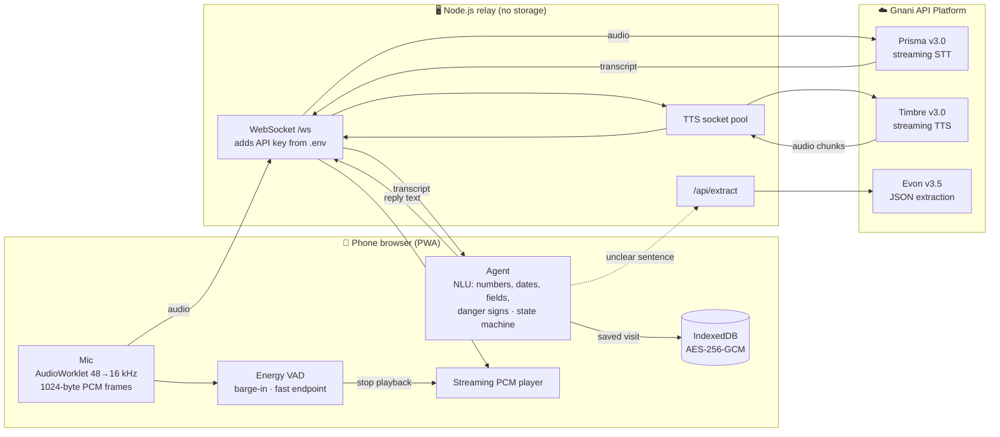

# ASHA Vaani: a voice field register for ASHA workers

**Track:** Healthcare – Voice field register for ASHA workers · **BolBharat, the Gnani Voice AI Innovation Challenge**

**▶ Live app:** _deployed link here_ · **🎬 Demo video (2½ min):** _video link here_

An ASHA worker walks out of a house and *speaks* her visit notes in Hindi, English or Kannada, mixed however she naturally
talks. Before she reaches the next house she has:

1. **A correct visit record**: beneficiary ID and name, visit type, weight, vitals, vaccines given and **vaccines due**
   (worked out from the national schedule), and the next visit date.
2. **The record read back aloud**, which she fixes by voice ("नहीं, वज़न 2.8 किलो").
3. **An immediate spoken danger-sign alert** in her language ("refer to the PHC now"), with the record flagged and one-tap
   108 / PHC call buttons.
4. **A follow-up list**: referrals first, then upcoming visits. She can ask "aaj ki list".

No typing. The app runs in the phone's browser and can be installed as a PWA on a low-end Android phone.

```
"सुनीता देवी, आईडी 1042, ए एन सी, वज़न 52 किलो, अगली विज़िट 3 दिसंबर"
→ "पढ़कर सुनाती हूँ। सुनीता देवी, आईडी एक शून्य चार दो। ए एन सी विज़िट। वज़न बावन किलो।
   बाकी टीके: टी डी दूसरा। अगली विज़िट तीन दिसंबर। क्या सब सही है?"
"हाँ" → saved (encrypted on the phone) → follow-up list updated
```

---

## Try it in 2 minutes

Requirements: Node.js 20+ and a Gnani API key from https://app.gnani.ai/voice.

```bash
git clone <this repo> && cd asha-vaani
npm install
cp .env.example .env          # then put your key in GNANI_API_KEY=...
npm start                     # http://localhost:3000
```

Open http://localhost:3000 in Chrome, tap the big mic, allow microphone access, and talk.

- **No key yet?** It still runs. The header shows `browser speech`, and the app falls back to the browser's speech
  recognition and voice. Gnani is used automatically once `GNANI_API_KEY` is set.
- **No mic?** Settings → *Type a note* sends text straight to the same agent.
- **On a phone:** the mic needs HTTPS, so use the deployed link (below) or a tunnel such as `npx localtunnel --port 3000`.

### Demo script (what we say to the judges)

| Say | What happens |
|---|---|
| *(tap mic)* | The agent says it is an AI assistant, not a human, in the selected language |
| "Sunita ki visit, wajan 50 kilo" | Two Sunitas are in the register, so it asks which one (ward / husband / ID) |
| "ward 3 wali" | Resolves to Sunita Devi 1042. Visit type ANC comes from the register |
| "agli visit do hafte baad, bas" | Fills the date, then reads the whole form back |
| "nahi, weight 52 kilo" *(while it is still talking)* | Barge-in: it stops at once, fixes the weight and reads back only what changed |
| "haan" | Saved and encrypted. The follow-up list updates |
| "Rekha Devi 1083, khoon aa raha hai" | Spoken danger alert straight away, red banner, 108 / PHC buttons |
| "bukhar ke liye kya dawai dein?" | Fixed refusal: no medicine advice, ask the ANM / PHC doctor |
| "aaj ki list" | Speaks the follow-ups, referrals first |

Synthetic register (all invented): `1042` Sunita Devi (ANC), `1043` Sunita Kumari (newborn), `1051` Priya Sharma (ANC),
`1057` Lakshmi Bai (child, 6 weeks), `1060` Fatima Begum (newborn, 2 days), `1066` Kavita Yadav (ANC, 36 wk),
`1071` Anjali Verma (child, 9 months), `1078` Meena Kumari (newborn), `1083` Rekha Devi (ANC), `1090` Shabnam Khatoon (child),
`1095` Gowramma (ANC), `1101` Savitha (child).

---

## Gnani API Platform services used

| Service | Model | Endpoint | What it does in ASHA Vaani |
|---|---|---|---|
| **Speech-to-Text, realtime streaming** | Prisma v3.0 | `wss://api.vachana.ai/stt/v3/stream` | Live transcription of the ASHA's notes. Code-mix languages `hi-IN,en-IN` / `kn-IN,en-IN`, `format=transcribe` so numbers come back as digits, **keyterms** (register names + health words like "TT injection", "IFA goli", "ANC"), a `topic` hint, VAD tuned for household and street noise, and `commit` for fast endpointing on short answers |
| **Text-to-Speech, realtime streaming** | Timbre v3.0 (voice Sunaina, recommended for Hindi, English and Kannada) | `wss://api.vachana.ai/api/v1/tts` | Speaks every reply: greeting with AI disclosure, questions, read-back, danger alerts. Raw 24 kHz PCM is streamed and played chunk by chunk. A pool of pre-opened sockets removes handshake delay |
| **LLM, Chat Completions (JSON output)** | Evon v3.5 | `https://api.vachana.ai/v1/chat/completions` | Optional backup extractor for sentences the rule parser couldn't understand. JSON only. It fills empty fields or adds danger flags, and can never overwrite or speak |

All three calls are made from the server (`server/gnani.js`) with the `X-API-Key-ID` header read from `.env`. The key never reaches the browser.

**Platform rules compliance:** WebSocket streaming only (no telephony or phone numbers) · STT = **Prisma v3.0** · TTS =
**Timbre v3.0** · custom orchestration written in this repo (no hosted end-to-end agent platform in the loop) · no voice
cloning. Without a key the app falls back to browser speech for local development only. The submitted deployment always
runs on Gnani.

## How it works



Same flow in plain text:

```
 Phone (browser PWA)                                Node server (stateless)              Gnani
 ─────────────────────────────────────────          ─────────────────────────            ──────────────────────
 mic ─► AudioWorklet: 48k→16k, 1024-byte frames ─ws─► relay (adds API key) ─────────ws──► Prisma v3.0 streaming STT
        energy VAD (barge-in, fast endpoint)                                               keyterms = register names +
                                                                                           health words, VAD tuned for noise
 agent ◄──────── transcript JSON ◄──────────────────── relay ◄─────────────────────────── transcript / speech_start
   │  deterministic NLU (<1 ms): numbers, dates,
   │  fields, danger signs, intents, corrections
   ▼
 reply text ───────────────────────────────────ws─► relay ── warm socket pool ──────ws──► Timbre v3.0 (24 kHz PCM)
 gapless PCM player ◄── streamed chunks ◄──────────── relay ◄───────────────────────────── audio chunks
 IndexedDB (AES-256-GCM) ◄── saved record
                         optional ──► /api/extract ──► Evon LLM (JSON only, fills gaps, can't overwrite)
```

### Speech layer

| Requirement | How we meet it |
|---|---|
| **Streaming end to end** | Mic audio streams to Prisma in 32 ms frames. Transcripts arrive per utterance. Timbre audio streams back and starts playing on the first chunk. |
| **Time to first audio** | Understanding is deterministic and runs in under 1 ms. TTS sockets are pre-opened so there is no handshake per reply. Fixed prompts are synthesised once and cached for instant replay. The live ⚡ badge shows the measured end-of-speech → first-audio time and its median. |
| **Barge-in** | A local VAD on the phone detects her voice over the agent (higher threshold while the agent talks, so echo isn't mistaken for her). Playback stops instantly and the server TTS stream is cancelled. Prisma's `speech_start` also ducks the agent's volume. Transcripts that repeat the agent's own words are dropped as echo. |
| **Endpointing** | Dictation uses Prisma VAD with a 700 ms silence so "wajan… 52 kilo" stays one phrase. For short answers (yes/no, a number, a date) the client sends `commit` after 350 ms of local silence. Hold-to-talk mode commits on release. A follow-up question waits 450 ms in case she keeps talking. |
| **Code-mix** | Prisma v3.0 with `hi-IN,en-IN` (or `kn-IN,en-IN`). The parser romanises every Indic script with one table (the Unicode Brahmic blocks share a layout), then matches on phonetic keys, so "वज़न", "wajan" and "vajan" are the same word. |
| **Noise** | Browser noise suppression and echo cancellation, a stricter Prisma VAD (`threshold 0.6`, `min-speech 200 ms`, `min-segment 200 ms`), keyterm biasing for names and health words ("TT injection", "IFA goli", "ANC checkup"), and hold-to-talk for very loud streets. |
| **Names and numbers** | Spoken numbers in Hindi, English and Kannada: "बावन", "teen sau chaalis", "do point aath", "dhai", "sava", "saadhe", "ek zero chaar do" (read as a digit string for IDs), "ippattondu", grams↔kg. IDs are read back digit by digit. Register names are fuzzy-matched, and same-name collisions are asked about, never guessed. |

### Fit for the target user

- One big button, then hands-free. No typing, large text, high contrast, works in sunlight, dark mode for night visits.
- Runs in Chrome on any Android phone and installs as a PWA. The app shell works offline.
- Speaks Hindi, English and Kannada, and switches automatically when two utterances in a row come in another language.
- Asks for only what's missing ("वज़न कितना है?"). It proposes the next visit date from the protocol and she just says "हाँ".
- Vaccines due are calculated from the National Immunization Schedule using the child's age or the pregnancy, so she doesn't have to remember the schedule.

---

## Responsible AI and compliance

| Baseline rule | Implementation |
|---|---|
| **AI disclosure** in the first turn, in her language | Every greeting starts "मैं … एक ए आई सहायक हूँ, इंसान नहीं" / "I am … an A I assistant, not a human" / Kannada equivalent. Covered by a test. |
| **Synthetic or consented data only** | The register is invented (`public/js/nlu/registry.js`). The UI shows a "synthetic beneficiaries only" banner. |
| **DPDP: encrypted at rest, deleted after judging** | Records are encrypted on the phone with AES-256-GCM (non-extractable WebCrypto key) and deleted automatically after 1 / 7 / 30 days, plus a "Delete all" button. The server stores and logs **no** audio or transcripts. |
| **Health: no diagnosis, treatment or dosage** | Every spoken sentence comes from fixed templates (`public/js/i18n.js`); nothing is generated freely. Medicine and treatment questions get a fixed refusal. Danger signs follow a fixed, cited list (see [DANGER_SIGNS.md](DANGER_SIGNS.md)) and the only action is "refer to PHC". The LLM can only return JSON fields, which are checked against the transcript and can only fill empty fields or add flags. |
| **Secrets** | The API key is read from `.env` (git-ignored) on the server and never reaches the browser. |
| **Voices** | Stock Gnani Timbre v3.0 voice (Sunaina) only. No cloning. |

---

## Accuracy

`npm run eval:text` scores the understanding layer on 43 judge-style notes (Hindi, Hinglish, English, Kannada; complete
notes, danger signs, negations and look-alikes such as "khoon ki kami" and "baby is fit"):

```
field accuracy:      65/65 (100.0%)
danger-sign recall:  28/28 (100.0%)
false flags:         0
```

This is our own test set, so treat it as a regression guard, not an independent benchmark.
`npm run eval:audio -- 10` runs the same notes end to end through Timbre v3.0 TTS (different voices from the app's), street-like noise at 10 dB SNR and Prisma
streaming STT, and reports the same scores plus STT latency.

`npm test` runs the dialogue tests: full visit, voice correction, barge-in-style correction, same-name disambiguation,
danger escalation, negation, refusal, Kannada flow, vaccine schedule and follow-ups.

---

## Deploy

**Render (free):** push to GitHub, then *New → Blueprint* and pick this repo (`render.yaml` is included). Set
`GNANI_API_KEY` in the dashboard. WebSockets and HTTPS work out of the box.
Free instances sleep after 15 minutes idle, so point a free uptime pinger (for example cron-job.org) at `/healthz` every
10 minutes during judging.

Any Node host with WebSockets works the same way (Railway, Fly.io, a VM): `npm ci && npm start`.

## Project layout

```
server/index.js        HTTP + one WebSocket per phone, relays to Gnani, no storage
server/gnani.js        Prisma STT stream, Timbre TTS socket pool, Evon JSON extractor
public/js/app.js       mic → STT → agent → TTS loop, barge-in, endpointing, latency meter, UI
public/js/audio.js     mic capture, energy VAD, streaming PCM player
public/js/agent.js     dialogue state machine: dictate → ask → read back → confirm/correct → save
public/js/i18n.js      every sentence the agent can say (hi / en / kn)
public/js/store.js     AES-GCM encrypted IndexedDB records, follow-up list
public/js/nlu/         translit (all Indic scripts), numbers, dates, fields, danger signs, schedules, register
scripts/               text and noisy-audio evaluations
test/                  dialogue tests (node:test)
```

MIT licence. Built for BolBharat 2026.
